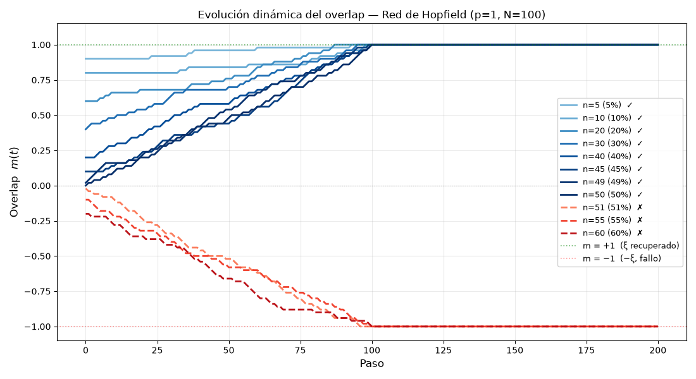
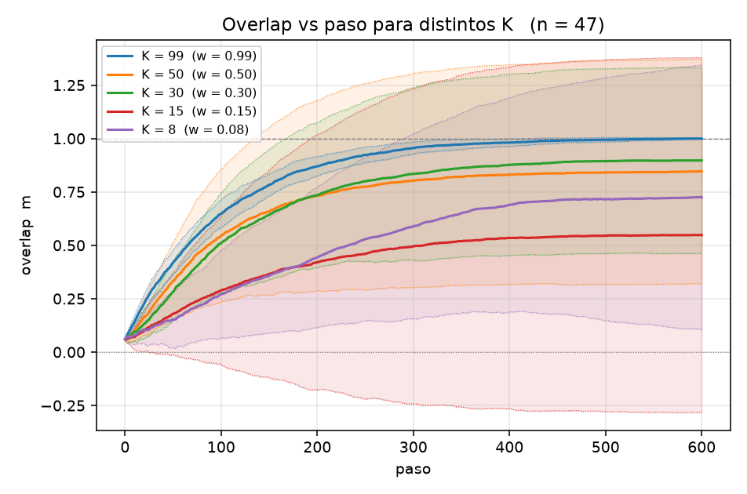

# Hopfield networks and attractor dynamics

Associative memory in Hopfield networks: recall of a stored pattern under noise, the effect of diluting the synapses, and a study of depth in feed-forward networks trained with backpropagation. Written in Python (NumPy, scikit-learn) for the Neural Networks course of the M.Sc. in Advanced Physics (Computational Physics), UNED.


*Hopfield network with N = 100 neurons storing one pattern (a 10×10 letter "A"). Starting from the pattern with n flipped bits, the network recovers it (overlap → +1) whenever n ≤ N/2. Beyond that it falls into the inverted state (overlap → −1), as theory predicts.*

| Folder | Model | What it shows |
|---|---|---|
| [`01-hopfield-pattern-recall`](01-hopfield-pattern-recall) | Hopfield network, Hebb rule, one stored pattern, asynchronous dynamics | Time evolution of the overlap for increasing noise; the 2n < N recovery condition |
| [`02-diluted-attractor-networks`](02-diluted-attractor-networks) | Diluted Hopfield network with fixed-degree dilution (Canning–Gardner convention: random K-regular synapse mask) | Overlap vs connectivity K; non-determinism; basins of attraction; signal-to-noise analysis |
| [`03-mlp-depth-study`](03-mlp-depth-study) | Multilayer perceptron (scikit-learn) on the South German Credit dataset | Train and test accuracy and convergence vs number of hidden layers. Beyond 3 layers, training collapses to the majority-class accuracy (0.70) |


*Diluted network: mean overlap (± one standard deviation over realisations) for different numbers of connections per neuron K. Recall degrades as the network is diluted.*

## Usage

```bash
pip install -r requirements.txt
cd 01-hopfield-pattern-recall && python main.py
cd 02-diluted-attractor-networks && python main.py   # figures saved in the folder
cd 03-mlp-depth-study && python main.py              # downloads the dataset from GitHub
```

Code comments and plot labels are in Spanish.
